<h1 align="center">🔎 Footprinting & Reconnaissance with Kali Linux Tools</h1>

<p align="center"><b>Passive reconnaissance of a live website using six built-in Kali Linux tools</b></p>

<p align="center">
  
  
  
  
  
  
  
</p>

---

## 📌 Project Overview

Reconnaissance (footprinting) is the first step in any real attack or security test. Before touching a target, an attacker collects as much public information about it as possible: who owns the domain, its real IP address, the hosting provider, the web technologies it runs, its DNS and mail records, and whether a firewall protects it.

In this project I footprinted the lab target **networkwalks.com** using six built-in Kali Linux tools. Each tool reveals a different piece of the target, and together they build a full profile of it. This work is the foundation for the scanning and attack projects that follow.

---

## 🎯 Objectives

- Find the domain registration details with `whois`
- Fingerprint the web technologies with `whatweb`
- Resolve the domain to its IP address with `nslookup`
- Read the HTTP response headers with `curl -I`
- Detect a Web Application Firewall with `wafw00f`
- Enumerate DNS records with `dnsrecon`
- Record every output with screenshots and text files

---

## ⚙️ Lab Environment

| 🧩 Component | ⚙️ Configuration |
|---|---|
| 🧰 Hypervisor | VMware Workstation Pro |
| 🖥️ Host OS | Windows 11 |
| 🐉 Attacker machine | Kali Linux 2026.3 (rolling) |
| 🧠 VM resources | 3 GB RAM, 2 processors |
| 🌐 VM network mode | NAT |
| 🎯 Target | networkwalks.com (provided for this lab) |
| 📅 Date performed | 9 November 2026 |

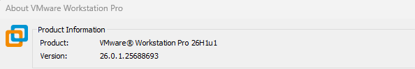

---

## 🧰 Tools Used

| Tool | Purpose |
|---|---|
| `whois` | Domain registration details |
| `whatweb` | Web technology fingerprinting |
| `nslookup` | Domain to IP resolution |
| `curl -I` | HTTP response headers |
| `wafw00f` | Web Application Firewall detection |
| `dnsrecon` | DNS record enumeration |

---

## 🪜 Tasks and Results

### Task 1. Domain Registration Details (`whois`)

```bash
whois networkwalks.com
```

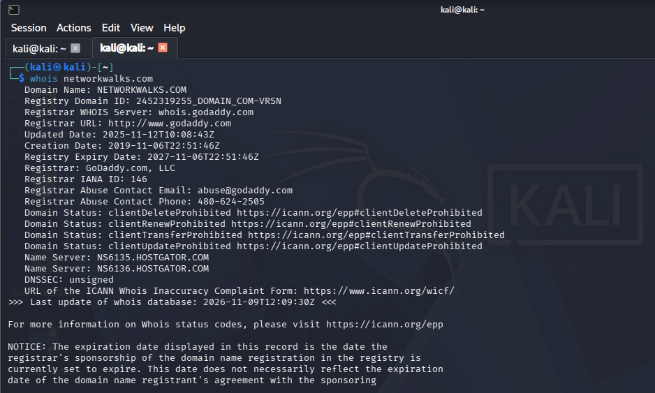

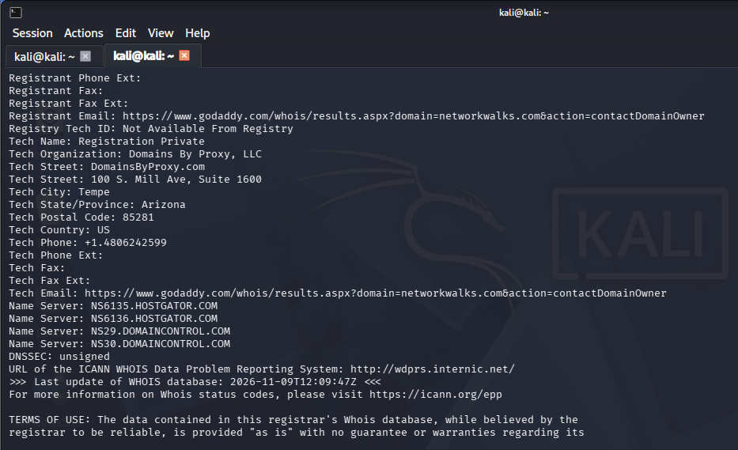

<details>
<summary>Show the remaining whois screenshots</summary>

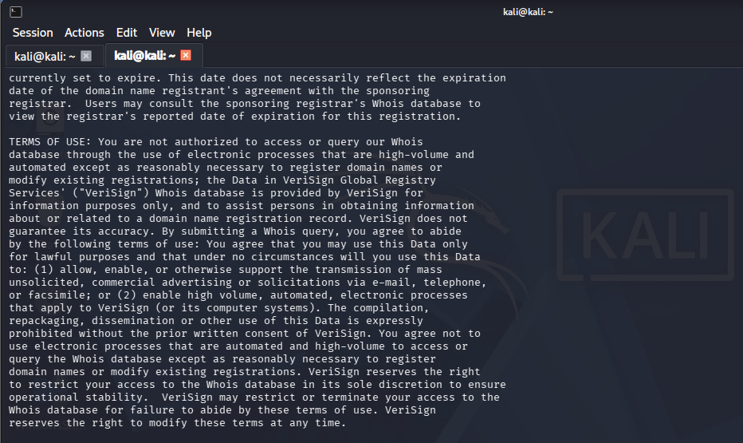

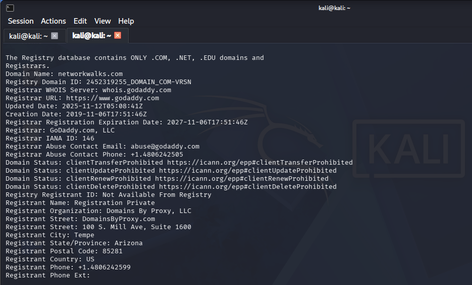

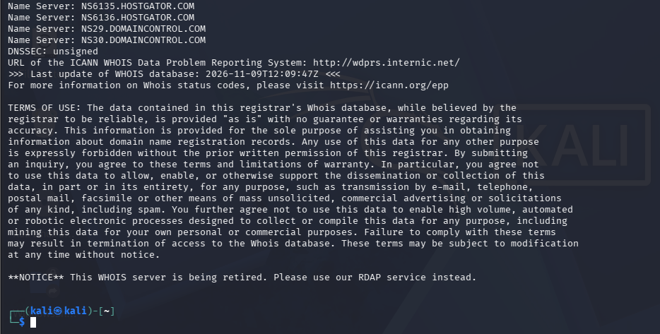


</details>

**Findings:**

- Registrar: GoDaddy.com, LLC (IANA ID 146)
- Created: 2019-11-06 | Updated: 2025-11-12 | Expires: 2027-11-06
- Registrant details are hidden by a privacy service (Domains By Proxy, LLC)
- Name servers: `NS6135.HOSTGATOR.COM`, `NS6136.HOSTGATOR.COM`, `NS29.DOMAINCONTROL.COM`, `NS30.DOMAINCONTROL.COM`
- Domain locks are set (transfer, update, renew, and delete prohibited)
- DNSSEC: unsigned

**Why it matters:** The HostGator name servers reveal the hosting provider. Registration dates and abuse contacts can help with social engineering, while the privacy service shows how an owner can hide personal details.

📄 Raw output: [outputs/01-whois.txt](outputs/01-whois.txt)

---

### Task 2. Web Technology Fingerprinting (`whatweb`)

```bash
whatweb networkwalks.com
```

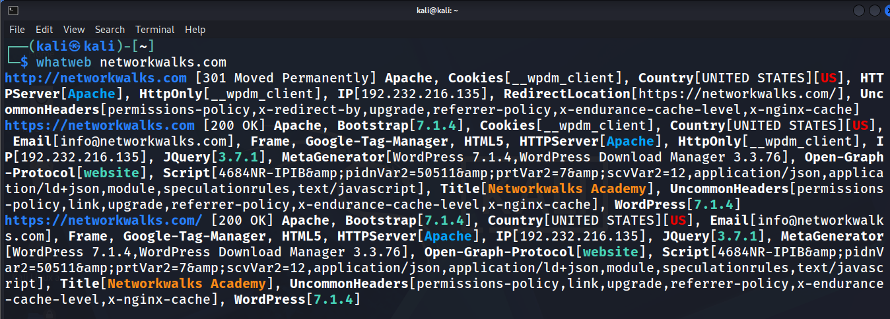

**Findings:**

- The HTTP site redirects (301) to HTTPS
- Web server: Apache
- CMS: WordPress 7.1.4, with the WP Download Manager plugin 3.3.76
- Other technologies: jQuery 3.7.1, Google Tag Manager, HTML5
- Server IP `192.232.216.135` and a contact email address are exposed
- A cookie named `__wpdm_client` is set with the HttpOnly flag

**Why it matters:** Exact software versions can be looked up in vulnerability databases to find known exploits.

📄 Raw output: [outputs/02-whatweb.txt](outputs/02-whatweb.txt)

---

### Task 3. DNS Resolution (`nslookup`)

```bash
nslookup networkwalks.com
```

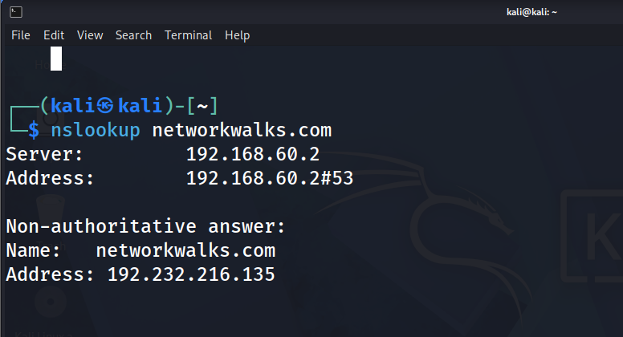

**Findings:**

- Resolved through the VMware NAT DNS service
- `networkwalks.com` resolves to **192.232.216.135** (non-authoritative answer)

**Why it matters:** Knowing the real IP lets an attacker scan the server directly, find other sites on the same IP, and map the infrastructure.

📄 Raw output: [outputs/03-nslookup.txt](outputs/03-nslookup.txt)

---

### Task 4. HTTP Response Headers (`curl -I`)

```bash
curl -I https://networkwalks.com
```

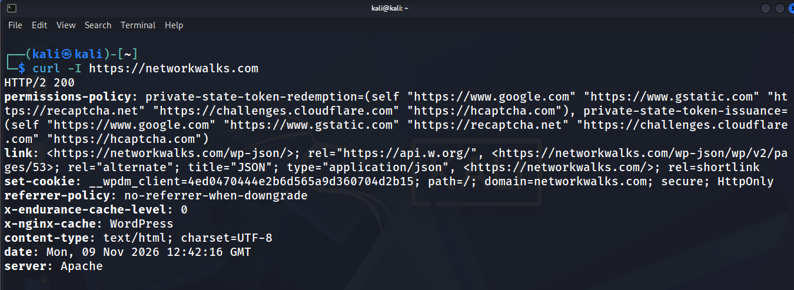

**Findings:**

- Status: `HTTP/2 200`
- `server: Apache`
- `x-nginx-cache: WordPress` shows a caching layer in front of WordPress
- The `link` header reveals the WordPress REST API at `/wp-json/`
- The session cookie is set with the `secure` and `HttpOnly` flags

**Why it matters:** Headers leak the web server, caching stack, and hidden endpoints, so attackers can fingerprint the stack without loading the full page.

📄 Raw output: [outputs/04-curl-headers.txt](outputs/04-curl-headers.txt)

---

### Task 5. Web Application Firewall Detection (`wafw00f`)

```bash
wafw00f networkwalks.com
```

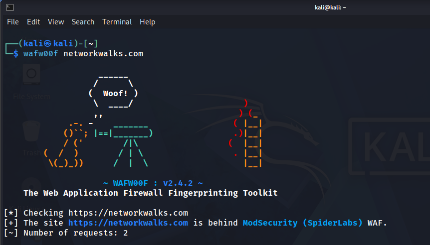

**Findings:**

- The site is behind a **ModSecurity (SpiderLabs) WAF**
- wafw00f v2.4.2 needed 2 requests to detect it

**Why it matters:** A WAF changes the whole attack approach, because naive attempts will be blocked or logged and an attacker must adapt.

📄 Raw output: [outputs/05-wafw00f.txt](outputs/05-wafw00f.txt)

---

### Task 6. DNS Record Enumeration (`dnsrecon`)

```bash
dnsrecon -d networkwalks.com
```

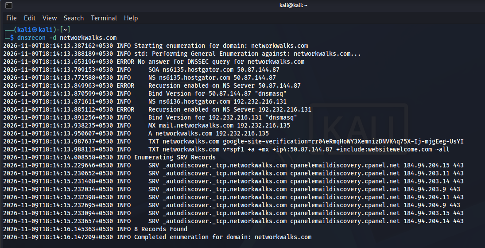

**Findings (8 records found):**

- SOA and NS records on HostGator name servers (`ns6135` and `ns6136`)
- Both name servers answered the version query with `dnsmasq`
- dnsrecon reported **recursion enabled** on both name servers
- No answer to the DNSSEC query
- MX record: `mail.networkwalks.com` (192.232.216.135)
- A record: `192.232.216.135`
- TXT records: an SPF policy and a Google site verification
- SRV records for cPanel email autodiscovery

**Why it matters:** The DNS records show the email and hosting setup, and each one is a potential foothold. Exposed server banners and enabled recursion are also things defenders should review.

📄 Raw output: [outputs/06-dnsrecon.txt](outputs/06-dnsrecon.txt)

---

## 📊 Summary of Findings

| 🔎 Item | 📋 Result | 🧰 Tool |
|---|---|---|
| Registrar | GoDaddy.com, LLC | whois |
| Domain created / expires | 2019-11-06 / 2027-11-06 | whois |
| Hosting provider | HostGator | whois, dnsrecon |
| Server IP | 192.232.216.135 | nslookup, whatweb |
| Web server | Apache | whatweb, curl |
| CMS | WordPress 7.1.4 | whatweb |
| Plugin | WP Download Manager 3.3.76 | whatweb |
| WAF | ModSecurity (SpiderLabs) | wafw00f |
| DNS server banner | dnsmasq | dnsrecon |
| Mail server | mail.networkwalks.com | dnsrecon |

---

## 🛡️ Defensive Takeaways

- Hide or remove software version information where possible.
- Keep the CMS and plugins updated, since exposed versions are easy to match against known vulnerabilities.
- Restrict access to endpoints that are not needed, such as the WordPress REST API.
- Review recursion and banner settings on public-facing name servers.
- Run the same tools against your own systems to see what an attacker would see.

---

## 💡 What I Learned

- Footprinting uses only public information, which is why it is powerful and hard to detect.
- Every tool exposes a different piece of the target, and the full picture comes from combining them.
- A WAF changes how an attack must be planned.
- Documenting outputs carefully is essential for a professional report.

---

## ⚠️ Disclaimer

This project is for **education and authorized security testing only**. The target, networkwalks.com, was provided for this lab by the course. Never run these tools against systems you do not own or have written permission to test.

---

## 👤 Author

**Gaurav Kudiya**
Cybersecurity Student, NetworkWalks B084M

LinkedIn: https://www.linkedin.com/in/gauravkudiya/

---

## 📌 Project Information

**Program Name:** Cybersecurity at Networkwalks | **Batch:** B084M | **Week:** 02 | **Project:** PM1 – Footprinting & Reconnaissance | **Repository:** GitHub
